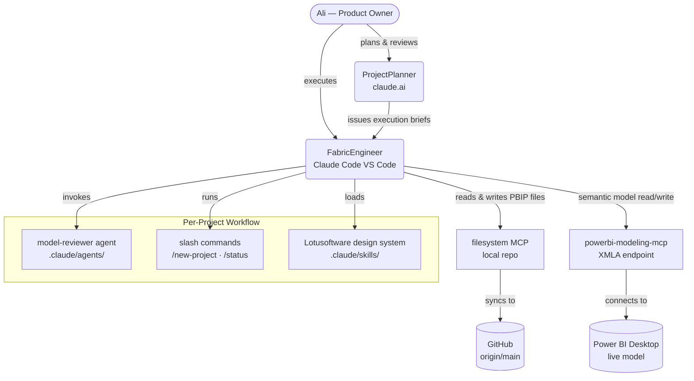

# Business Intelligence Projects

A BI-layer monorepo of Power BI, Excel, and SQL portfolio projects. All Power BI projects are in PBIP format with clean semantic models, Lotusoftware design system, and AI-ready measure libraries.

## Agentic Workflow

This repo uses a two-agent system powered by Claude and MCP tooling:



**ProjectPlanner** (`claude.ai`) — plans architecture, writes execution briefs, reviews audit results, issues prompts to FabricEngineer.

**FabricEngineer** (`Claude Code, VS Code`) — executes file operations, semantic model writes via `powerbi-modeling-mcp`, PBIR JSON fixes, git commits.

**model-reviewer** — subagent that audits any `.SemanticModel/` folder against star-schema, naming, DAX, and hygiene standards. Invoked before any model work.

## Projects

| Project | Format | Domain | Tables |
|---|---|---|---|
| [Finance Analysis](PowerBI_Finance_Analysis/) | PBIP ✓ | Personal finance / banking | `fact_Transactions`, `dim_Customer`, `dim_Date` |
| [Competitor Sales](PowerBI_Competitor_Sales_Analysis/) | PBIP ✓ | Retail sales / market share | `fact_Sales`, `dim_Product`, `dim_Geography`, `dim_Manufacturer`, `dim_Date` |
| [Ecommerce Analysis](PowerBI_Ecommerce_Analysis/) | PBIP ✓ | E-commerce / customer LTV | `fact_Sales`, `fact_Invoice_Totals`, `fact_Market_Baskets`, `dim_Customer`, `dim_Product`, `dim_State_Mapping`, `dim_Date` |
| [Supply Chain](PowerBI_Supply_Chain_Analysis/) | PBIP ✓ | Make vs. buy / cost avoidance | `fact_Quotes`, `fact_Mfg_Estimates`, `dim_Product`, `dim_Yield_Rate` |
| [Healthcare Analysis](PowerBI_Healthcare_Analysis/) | PBIP ✓ | Hospital discharges / LOS | `fact_Hospital_Discharges`, `dim_Surgical_Program` |
| [Customer Churn](Excel_Customer_Churn_Analysis/) | Excel | Churn prediction | — |
| [Nashville Housing](SQL_Nashville_Housing/) | SQL | Data cleaning | — |
| [Segmentation & Cohorts](SQL_Segmentation_Cohorts_Retention/) | SQL | Customer analytics | — |

## Semantic Model Standards

All Power BI semantic models follow these standards:

- **Star schema** — `fact_` (plural) and `dim_` (singular) naming
- **Hidden columns** — all FK, ID, and operational columns hidden from report view
- **DAX** — `VAR`/`RETURN` on all compound measures, display folders, Copilot descriptions on every measure
- **Table descriptions** — grain, source, and key limitations on every table
- **Design system** — Lotusoftware Layout Trifecta, `#197278` teal palette, max 4 intentional colours

## Repo Structure

```
.claude/
  agents/model-reviewer.md        ← semantic model audit agent
  commands/new-project.md         ← /new-project scaffold command
  commands/status.md              ← /status summary command
  skills/lotusoftware-dashboard-design/  ← design system (auto-loaded)
  settings.json                   ← tool permissions

_template/                        ← scaffold templates for new projects
  CLAUDE.md                       ← project context template (includes Analyst Mindset checklist)
  state.md
  decisions.md

projects/<slug>/                  ← per-project metadata
  CLAUDE.md                       ← goal, metrics, grain, stakeholders
  state.md                        ← current status and blockers
  decisions.md                    ← dated design decision log

PowerBI_<Name>/                   ← PBIP files (Desktop save path)
  <Name>.pbip
  <Name>.Report/
  <Name>.SemanticModel/

Analyst-Mindset-Framework.docx    ← project kickoff framework (Jon Christiansen, 27 episodes)
HARNESS.md                        ← hard-won PBIR/TMDL/MCP gotchas
```

## Key Learnings

Hard-won lessons from this repo are logged in [`HARNESS.md`](HARNESS.md). Highlights:

- PBIR JSON table renames require updates to both `"Entity"` values **and** `"queryRef"` dot-prefix strings
- filesystem MCP writes UTF-8 BOM on Windows — always strip with Python after any `.Report/` JSON edit
- TMDL partition names, `PBI_QueryOrder`, `diagramLayout.json` nodeIndex keys, and annotation embedded JSON all carry table names and must be updated after renames

## Tools & MCP Servers

| Tool | Purpose |
|---|---|
| `powerbi-modeling-mcp` (local, `plugin:powerbi-authoring`) | Semantic model read/write via XMLA |
| `filesystem` MCP | Read/write repo files |
| Power BI Desktop | PBIP authoring, visual verification |

---

*Ali Saghi · [Lotusoftware](https://lotusoftware.hashnode.dev) · [LinkedIn](https://linkedin.com/in/ali-saghi-fabric)*
