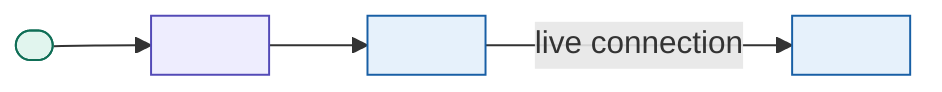

# <!-- Project Title --> — <!-- One-line tagline: what question does this answer? -->

<!-- One paragraph: what this project is, what dataset it uses, and what it delivers.
     Source: CLAUDE.md > Goal + Data sources. -->

---

## The Problem

<!-- 2–4 sentences describing the business problem in plain language.
     Source: CLAUDE.md > Goal + Stakeholders.
     For portfolio/learning projects: frame the analytical question instead of a business unit. -->

---

## Architecture

<!-- For projects with a Python ingestion step, add a pipeline node:
    E([scripts/\ningestion]) -->|writes| B
    style E fill:#FAEEDA,stroke:#854F0B,color:#633806 -->

---

## Key Technical Decisions

<!-- Bullet list of non-obvious modelling or design choices with the WHY.
     Source: decisions.md. One bullet per decision — lead with the choice, then the reason.
     Skip obvious defaults; include anything that would surprise a future analyst. -->

- **<!-- Decision title -->** — <!-- why this choice was made over the alternative -->
- **<!-- Decision title -->** — <!-- why this choice was made over the alternative -->

---

## What Was Built

| Artifact | Type | Description |
|---|---|---|
| `<!-- rpt_Name -->` | Report | <!-- N-page Power BI report — page titles --> |
| `<!-- sm_Name -->` | Semantic model | <!-- Import/DirectQuery · _Measures table · N DAX measures · N display folders --> |
| `scripts/<!-- name.py -->` | Python script | <!-- What it does: ingest, clean, output --> |

<!-- Remove the scripts row if there is no ingestion script.
     Add rows for Excel workbook, SQL file, or other artefacts as appropriate. -->

---

## Semantic Model — DAX Measure Library

<!-- N measures across N display folders, all using VAR/RETURN pattern.
     Source: CLAUDE.md > Metrics / KPIs.
     One row per display folder — describe what business question it answers. -->

| Display folder | What it answers |
|---|---|
| <!-- KPIs --> | <!-- Top-line totals --> |
| <!-- Time Intelligence --> | <!-- Period-over-period comparisons --> |

---

## Report Pages

<!-- One entry per report page. List the key visuals and slicers on each page.
     Source: state.md or direct observation in Power BI Desktop. -->

**Page 1 — <!-- Page name -->**
<!-- Key visuals, KPI cards, slicers. -->

**Page 2 — <!-- Page name -->**
<!-- Key visuals, KPI cards, slicers. -->

---

## Key Findings

<!-- 3–5 bullet points of actual findings from the data.
     Source: CLAUDE.md notes, decisions.md, or analytical output.
     For portfolio projects still in progress, replace with "In progress — findings will be added here."
     Include analyst blind spots: data limits, what this analysis cannot prove. -->

- <!-- Finding -->
- <!-- Finding -->

**Analyst blind spots acknowledged:** <!-- data limits, what this cannot prove — Source: CLAUDE.md > Constraints -->

---

## How to Explore This Project

<!-- Navigation guide — tell a reader where to find what in the repo. -->

- **Report:** `<!-- rpt_Name.Report/definition/pages/ -->` — PBIP visual JSON per page
- **Semantic model:** `<!-- sm_Name.SemanticModel/definition/tables/_Measures.tmdl -->` — all DAX measures
- **Ingestion script:** `scripts/<!-- name.py -->` — data preparation; expects source files in `_data/`, writes to `_output/`
- **`CLAUDE.md`** — project goal, KPIs, grain, data sources, stakeholders, constraints, Analyst Mindset checklist
- **`decisions.md`** — dated log of design decisions with rationale
- **`state.md`** — current status, blockers, and next actions

<!-- Remove script line for SQL/Excel projects with no Python ingestion. -->

---

## Data

<!-- Grain, row count, date range, source, known quality issues.
     Source: CLAUDE.md > Grain + Data sources + Constraints. -->

| Field | Detail |
|---|---|
| Source | <!-- dataset name and origin --> |
| Grain | <!-- one row = one X --> |
| Rows | <!-- N rows --> |
| Date range | <!-- YYYY–YYYY --> |
| Known gaps | <!-- any documented quality issues or exclusions --> |

---

*Built by [Ali Saghi](https://www.linkedin.com/in/ali-saghi-fabric/) · [Lotusoftware](https://lotusoftware.hashnode.dev) · <!-- Month YYYY -->*
