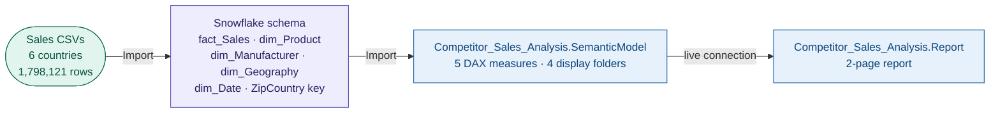

# Competitive Sales Intelligence — Where should Sintec focus to defend and grow market share?

An end-to-end Power BI competitive intelligence report on ~1.8M sales transactions
across 6 countries and 14 competing manufacturers (2014–2021). Answers one question:
where should Sintec focus product, geography, and pricing strategy to defend and grow
market share against 13 competitors?

---

## The Problem

Sintec competes against 13 manufacturers across 6 countries but has no structured way
to assess whether its revenue performance reflects internal execution or external market
dynamics.

**No competitive view.** Revenue data exists per country but is never joined to
manufacturer context — it is impossible to know whether Sintec is gaining or losing
market share without manually combining six regional files.

**Duplicate Zip codes across countries.** The same postal code appears in multiple
countries, making a simple Zip-based join between Sales and Geography incorrect. A
composite `ZipCountry` key is required.

**Country naming inconsistency.** The Geography source stores `"USA"` while Sales
assigns `"United States"` to US rows — causing all 753,619 US rows to become geography
orphans on a naive join.

---

## Architecture

---

## Key Technical Decisions

- **`ZipCountry` composite key (`Sales[Zip] & "," & Sales[Country]`)** — Zip codes
  are not globally unique across the 6 source countries. A plain Zip join produces
  incorrect geographic attributions. The composite key resolves cross-country collisions.

- **AI visuals (Decomposition Tree, Key Influencers) on the Advanced Insights page** —
  replaces the need to build a separate pivot analysis for every hypothesis; Key
  Influencers surfaces statistical associations that static charts would obscure.

- **Snowflake schema: `fact_Sales` → `dim_Product` → `dim_Manufacturer`** — the
  two-hop path is intentional; denormalising ManufacturerID into the fact table was
  evaluated and rejected to keep the model clean and the relationship chain explicit.

- **Known geographic coverage gap documented, not silently dropped** — 1,530 US Zip
  codes present in Sales have no matching row in Geography (7.38% of US rows). These
  are excluded from region/district breakdowns; revenue totals are unaffected. The gap
  is surfaced in report notes rather than hidden.

---

## What Was Built

| Artifact | Type | Description |
|---|---|---|
| `Competitor_Sales_Analysis.Report` | Report | 2-page Power BI report — Competitor Sales Analysis, Advanced Insights |
| `Competitor_Sales_Analysis.SemanticModel` | Semantic model | Import · snowflake schema · ZipCountry composite key · `_Measures` table · 5 DAX measures |

---

## Semantic Model — DAX Measure Library

| Display folder | What it answers |
|---|---|
| Volume | Revenue, Units Sold — base aggregates in filter context |
| Competitive | Sintec Revenue (manufacturer-filtered), Sintec Market Share % |
| Time Intelligence | PY Sales, % Growth (YoY revenue change) |

---

## Report Pages

**Page 1 — Competitor Sales Analysis**
Revenue by manufacturer (ranked bar), market share % for Sintec vs. competitors,
geographic breakdown by country and region. Slicers: country, year, manufacturer.

**Page 2 — Advanced Insights**
Decomposition Tree (revenue by segment × category × manufacturer), Key Influencers
visual (factors associated with higher/lower revenue). Enables hypothesis-driven
exploration without building a separate pivot for every question.

---

## Key Findings

- **Sintec leads the US market at 38.22% share**; global share is 21.15% — the gap
  indicates untapped potential in the other 5 markets.
- **Artisans dominates Germany with >50% share** — not a near-term Sintec expansion
  candidate without a differentiated product play.
- **2021 showed 18.8% YoY revenue growth** — strongest year in the dataset; fragile
  without 2022+ data to confirm trend vs. peak.
- **Segment × geography interaction** — the same product segment performs differently
  by country; a single global segment strategy is blunt.

**Analyst blind spots acknowledged:** Dataset ends 2021 — momentum conclusions are
fragile without more recent data. Revenue ≠ profitability; no margin data is available.
7.38% of US rows lack a geography match — geographic visuals undercount US by this margin.
Competitor revenue figures share the same source as Sintec — no independent validation.

---

## How to Explore This Project

- **Report:** `Competitor_Sales_Analysis.Report/definition/pages/` — PBIR visual JSON per page
- **Semantic model:** `Competitor_Sales_Analysis.SemanticModel/definition/tables/_Measures.tmdl` — all DAX measures
- **`CLAUDE.md`** — project goal, KPIs, grain, data sources, ZipCountry key rationale, known gaps
- **`decisions.md`** — dated log of design decisions with rationale
- **`state.md`** — current status, blockers, and next actions

---

## Data

| Field | Detail |
|---|---|
| Source | Public sales dataset — 6 regional CSVs + bi_dimensions.xlsx (Product, Manufacturer, Geography) |
| Grain | One row per sales transaction (ProductID × Date × Zip × Country) |
| Rows | ~1.8M transactions |
| Date range | 2014 – 2021 |
| Known gaps | 1,530 US Zip codes absent from Geography (7.38% of US rows — geography visuals only) |

---

*Built by [Ali Saghi](https://www.linkedin.com/in/ali-saghi-fabric/) · [Lotusoftware](https://lotusoftware.hashnode.dev) · October 2026*
