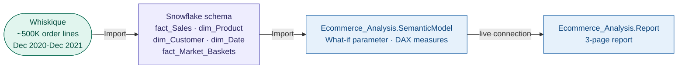

# E-Commerce Performance & Cost Optimisation — Shipping break-even and cross-sell signals for Whiskique

An end-to-end Power BI report on the Whiskique pet supply dataset (~500K order lines)
answering two levers that together determine net profitability: where shipping costs can
be reduced without hurting revenue, and which product combinations most reliably drive
cross-sell and upsell conversions.

---

## The Problem

Whiskique's operations team needs to know where shipping costs can be reduced without
hurting revenue. Its marketing team needs to know which product combinations most
reliably drive cross-sell conversions. Both questions share the same transactional data
but require different analytical structures — a shipping cost model and a market basket
correlation matrix.

**Shipping at 25% of revenue.** At $385K on $1.55M revenue, shipping is the primary
cost lever. Identifying the quantity break-even point where consolidation saves money
requires dynamic recalculation across a volume range — not a static table.

**No joined market basket view.** Product pair affinity cannot be calculated from
`fact_Sales` alone without a self-join structure that standard star schemas do not
support natively. A calculated duplicate fact table with M:M cross-filter is required.

---

## Architecture

---

## Key Technical Decisions

- **What-if parameter (Blended Shipping Cost Factor)** — all shipping measures
  recalculate dynamically; cost curves plotted across the full volume range make
  the break-even point visible without manual calculation or rebuilding visuals.

- **`fact_Market_Baskets` as a calculated duplicate of `fact_Sales` with M:M
  BothDirections on Invoice No** — enables product pair correlation without
  self-joins; the intentional M:M relationship is documented in `CLAUDE.md` to
  prevent future "cleanup" from removing it.

- **`dim_State_Mapping` M:M BothDirections on Order State** — intentional to allow
  region filtering to flow bidirectionally across the model.

- **Three-page decision progression** — Executive Summary (P&L overview) → Shipping
  Metrics (cost optimisation) → Market Basket Analysis (cross-sell candidates).
  Mirrors the actual workflow: understand the business first, then drill into the
  two optimisation levers.

- **`Buy Scenario Full Cost` uses `MINX + FILTER`** — selects minimum full cost
  supplier at scenario volume, not just unit cost; exposes whether advantage is from
  unit price or setup cost (two different negotiation levers).

---

## What Was Built

| Artifact | Type | Description |
|---|---|---|
| `Ecommerce_Analysis.Report` | Report | 3-page Power BI report — Executive Summary, Shipping Metrics, Market Basket Analysis |
| `Ecommerce_Analysis.SemanticModel` | Semantic model | Import · snowflake schema · What-if parameter · DAX measures · `fact_Market_Baskets` M:M |

---

## Semantic Model — DAX Measure Library

| Display folder | What it answers |
|---|---|
| Revenue & Margin | Total Sales, Profit Margin %, Profit — top-line P&L |
| Shipping | Shipping (Baseline), Shipping (What-if), Shipping (Difference) — cost optimisation |
| Customers | Customer LTV (Total Sales / Number of Customers) |
| Market Basket | Product correlation coefficients for cross-sell affinity |

---

## Report Pages

**Page 1 — Executive Summary**
Top-line KPI cards (Total Sales, Profit Margin %, Customer LTV), segment and
geography breakdowns. Entry point for C-suite and cross-team navigation.

**Page 2 — Shipping Metrics**
What-if parameter slider (Blended Shipping Cost Factor), cost curves by quantity,
state-level shipping cost vs. revenue scatter. Identifies break-even volume and
high-cost states.

**Page 3 — Market Basket Analysis**
Product pair correlation matrix, top cross-sell candidates ranked by affinity score.
Candidates for "frequently bought together" prompts.

---

## Key Findings

- **Total revenue $1.55M, profit margin 27.50% ($427K)**; shipping at $385K = 25%
  of revenue — the primary cost lever.
- **Quantity-based consolidation reduces per-order shipping ~30%** moving from 1 to
  2 units; diminishing returns beyond 4 units.
- **Market basket correlation matrix surfaces high-affinity product pairs** — candidates
  for "frequently bought together" prompts.
- **Certain states show disproportionately high shipping costs relative to revenue** —
  possible carrier or fulfilment centre inefficiencies worth investigating.

**Analyst blind spots acknowledged:** Whiskique is a fictitious dataset — patterns
are illustrative. LTV is a simple average (does not account for purchase frequency or
tenure). Shipping model assumes uniform discount structure, not real carrier tiers.
Correlation ≠ causation: cross-sell affinity requires an A/B test to confirm
incremental revenue effect.

---

## How to Explore This Project

- **Report:** `Ecommerce_Analysis.Report/definition/pages/` — PBIR visual JSON per page
- **Semantic model:** `Ecommerce_Analysis.SemanticModel/definition/tables/_Measures.tmdl` — all DAX measures and the What-if parameter
- **`CLAUDE.md`** — project goal, KPIs, grain, data sources, stakeholders, constraints, M:M relationship rationale
- **`decisions.md`** — dated log of design decisions with rationale
- **`state.md`** — current status, blockers, and next actions

---

## Data

| Field | Detail |
|---|---|
| Source | Whiskique fictitious pet supply dataset |
| Grain | One row per line item sold (Stock Code × Invoice No × Transaction Date) |
| Rows | ~500K order lines |
| Date range | Dec 2020 – Dec 2021 |
| Known gaps | LTV does not account for frequency or tenure; shipping model is uniform, not carrier-tiered |

---

*Built by [Ali Saghi](https://www.linkedin.com/in/ali-saghi-fabric/) · [Lotusoftware](https://lotusoftware.hashnode.dev) · October 2026*
