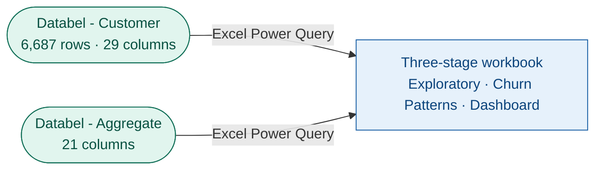

# Telecom Customer Retention Insights — Churn drivers and retention levers for Databel

An Excel-based customer churn analysis on the Databel fictitious telecom dataset
(6,687 customers) identifying which customers are most at risk of churning and what
demographic, contractual, and service factors drive attrition — structured across
three analytical stages from raw data exploration to an executive dashboard.

---

## The Problem

Databel's customer success managers need to know which customers are most at risk of
churning, and what factors drive that risk — so retention resources can be targeted
before high-value customers leave.

**Churn is the primary business risk.** At 26.86% churn rate (1,796 of 6,687 customers),
Databel is losing more than one in four customers. The existing reporting shows aggregate
churn but not the drivers — making targeted retention campaigns impossible to design.

**Competitor activity is the leading cause but not actionable alone.** 45% of departures
cite competitor reasons. Without decomposing which customer segments are most vulnerable
to competitive switching, the response is generic price cuts rather than targeted
retention offers.

---

## Architecture

---

## Key Technical Decisions

- **Three-stage workbook structure** — (1) Exploratory Analysis: data prep, duplicate
  detection, baseline churn metrics; (2) Churn Pattern Investigation: demographics,
  service plans, contract type, tenure, geography; (3) Executive Dashboard: KPI
  summary and actionable findings. Each stage builds on the previous rather than
  presenting all analysis on a single sheet.

- **`IF()` formula for Churned Binary column** — enables PivotTable aggregation of
  churn counts without filtering. Recalculates automatically on data refresh.

- **Nested `IF()` for age grouping and tenure segmentation** — industry-standard
  demographic bucketing; produces the meaningful age brackets (Senior 65+ vs. other
  groups) that surface the most significant churn signal.

- **PivotTables with calculated fields for churn rate** — avoids hard-coded percentages;
  recalculates on any filter or data change. Churn Rate = Churned Customers / Total
  Customers, calculated in-pivot rather than hard-coded per cell.

---

## What Was Built

| Artifact | Type | Description |
|---|---|---|
| `Customer-Churn-Analysis-in-Excel.xlsx` | Excel workbook | Three-stage analysis workbook — Exploratory, Churn Patterns, Executive Dashboard |

---

## Analysis Stages

**Stage 1 — Exploratory Analysis**
Data quality checks (duplicate detection, NULL audit), baseline churn rate calculation,
competitive churn breakdown. Establishes the analytical baseline before any segmentation.

**Stage 2 — Churn Pattern Investigation**
Demographics (age group, gender), service plan impact (unlimited data, international plan),
contract type and tenure correlation, geographic variations by state. Each dimension
tested independently before combining.

**Stage 3 — Executive Dashboard**
KPI summary (Churn Rate, Total Customers, Churned Customers), churn reason breakdown,
top demographic and contractual risk factors. Designed for a business stakeholder with
no analytical background.

---

## Key Findings

- **Churn rate: 26.86%** (1,796 of 6,687 customers); **Competitor activity drives 45%**
  of all departures.
- **Senior citizens (65+) show significantly higher churn rates** than other age groups —
  the highest-value demographic is the most at-risk.
- **Month-to-month contracts correlate with highest churn risk**; two-year contracts
  correlate with highest retention — contract migration is the strongest available lever.
- **Customers on unlimited data plans exhibit higher churn** — counterintuitive; warrants
  further investigation (possible product-fit mismatch).
- **Churn decreases significantly after the first year** — acquisition-period retention
  is the primary intervention window; onboarding programme is the highest-leverage fix.
- **Geographic variation exists at state level**, especially among customers with
  international plans — competitive pressure is not uniform across markets.

**Analyst blind spots acknowledged:** Databel is a fictitious dataset — patterns are
illustrative. Analysis is descriptive; predictive churn modelling requires a separate
ML layer. Correlation ≠ causation: A/B tests are needed to confirm that contract
migration or onboarding changes actually reduce churn.

---

## How to Explore This Project

- **Workbook:** `Customer-Churn-Analysis-in-Excel.xlsx` — open in Excel; workbook
  tabs are structured in the three analytical stages described above
- **`CLAUDE.md`** — project goal, KPIs, grain, data sources, constraints
- **`decisions.md`** — dated log of design decisions with rationale
- **`state.md`** — current status, blockers, and next actions

---

## Data

| Field | Detail |
|---|---|
| Source | Databel fictitious telecom dataset |
| Grain | One row per customer account |
| Rows | 6,687 customers · 29 columns |
| Known gaps | No temporal dimension; descriptive only — no predictive ML layer |

---

*Built by [Ali Saghi](https://www.linkedin.com/in/ali-saghi-fabric/) · [Lotusoftware](https://lotusoftware.hashnode.dev) · October 2026*
