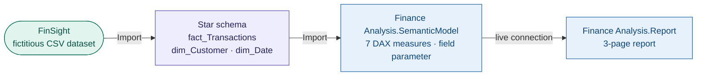

# Financial Transactions Dashboard — Trend, exceptions, and drill-through for FinSight finance leadership

An executive-facing Power BI report on the FinSight fictitious dataset answering two
questions at different levels of detail: macro transaction trends across segments and
geographies for C-suite, and specific operational exceptions (failed transactions,
anomalous fee patterns) for the operations team — served from a single report without
forcing either audience to navigate a page designed for the other.

---

## The Problem

FinSight's finance leadership needs visibility into transaction volumes, fees, and taxes
across customer segments and geographies. The existing reporting is static — there is no
way to switch between KPIs without navigating to a different page, no drill-through to
transaction detail, and no fast path to operational exceptions like failed transactions.

**Two audiences, one report.** C-suite need macro trends; operations need exception
management. A multi-page report designed for one audience forces the other to navigate
past irrelevant content on every session.

**Static metric views.** A separate page per KPI (Amount, Fees, Tax, Transactions)
quadruples page maintenance cost and prevents cross-KPI comparison on a single visual.

---

## Architecture

---

## Key Technical Decisions

- **Field parameter (`_Metrics`) drives a metric switcher** — four KPI views (Amount,
  Fees, Tax, Transactions) served from one page without duplicating visuals; dynamic
  chart title reflects the active metric. Reduces page count and maintenance cost.

- **F-pattern layout** — KPI cards and metric switcher placed in the top-left zone
  where executive attention lands first; supporting detail below and to the right.

- **Drill-through from Executive Summary to Transaction Details** — context filter
  preserved on landing; dynamic header (`Transaction Details: Retail`) confirms the
  active filter so the user always knows which slice they are examining.

- **Monthly State Tooltip** — hover on the monthly trend line to surface top states
  by active customer density for that month without navigating away from the page.

- **Conditional formatting on failed transactions** — warning-red tint makes
  exceptions scannable in a dense table without pre-filtering every session.

- **Negative amounts converted to absolute values** — prevents offsetting totals in
  aggregations; reversals are distinguishable via transaction-type filter. Documented
  trade-off: removes the reversal signal from raw amount aggregations.

---

## What Was Built

| Artifact | Type | Description |
|---|---|---|
| `Finance Analysis.Report` | Report | 3-page Power BI report — Executive Summary, Transaction Details, Operational Exceptions |
| `Finance Analysis.SemanticModel` | Semantic model | Import · `_Measures` table · 7 DAX measures · field parameter `_Metrics` |

---

## Semantic Model — DAX Measure Library

| Display folder | What it answers |
|---|---|
| KPIs | Total Amount, Total Fees, Total Tax, Total Transactions — top-line aggregates |
| Time Intelligence | PY Amount, YOY Amount, YOY% Amount — period-over-period trends via `SAMEPERIODLASTYEAR` |

---

## Report Pages

**Page 1 — Executive Summary**
Metric switcher (Amount / Fees / Tax / Transactions), KPI cards, monthly trend line
chart with State Tooltip, segment breakdown. Slicers: segment, year.

**Page 2 — Transaction Details**
Drill-through target from Executive Summary. Dense transaction table with conditional
formatting on failed transactions. Dynamic page header shows active filter context.

**Page 3 — Operational Exceptions**
Failed transaction rate, anomalous fee patterns, segment and geography breakdowns
for the operations team.

---

## Key Findings

- Field parameter switching materially reduces page count — the design pattern is worth
  replicating on any dashboard where multiple KPIs share the same dimensional structure.
- Conditional formatting on failed transactions makes exception management practical
  at scale without requiring a pre-filter step.
- Drill-through with dynamic titles eliminates the "what slice am I looking at?" problem
  in dense reports with multiple entry points.

**Analyst blind spots acknowledged:** FinSight is a fictitious dataset — findings
demonstrate the analytical pattern, not empirical conclusions. Negative amounts are
converted to absolute values; reversal analysis requires a transaction-type filter.
`dim_Date` covers 2023–2026; transactions outside that range produce blank PY and YOY
measures.

**Known blocker:** Visual field references for `(Calendar) Month Name` are broken —
date table was renamed from `Calendar` to `dim_Date` during the Oct 2026 hygiene pass
but `Entity` and `queryRef` values in PBIR visual JSON were not updated. Fix:
find-and-replace `Calendar` → `dim_Date` across `.Report/**/*.json`, then BOM-strip.

---

## How to Explore This Project

- **Report:** `Finance Analysis.Report/definition/pages/` — PBIR visual JSON per page
- **Semantic model:** `Finance Analysis.SemanticModel/definition/tables/_Measures.tmdl` — all DAX measures and the `_Metrics` field parameter
- **`CLAUDE.md`** — project goal, KPIs, grain, data sources, stakeholders, constraints
- **`decisions.md`** — dated log of design decisions with rationale
- **`state.md`** — current status, blockers, and next actions

---

## Data

| Field | Detail |
|---|---|
| Source | FinSight fictitious dataset |
| Grain | One row per financial transaction |
| Tables | `fact_Transactions`, `dim_Customer`, `dim_Date` (generated 2023–2026) |
| Known gaps | Negative amounts converted to absolute values; no reversal flag in source |

---

*Built by [Ali Saghi](https://www.linkedin.com/in/ali-saghi-fabric/) · [Lotusoftware](https://lotusoftware.hashnode.dev) · October 2026*
