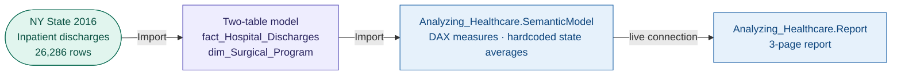

# Hospital Efficiency Benchmarking — Outlier detection for LOS and cost in NY elective hip replacement surgery

A Power BI report identifying which New York hospitals are statistical outliers in
length of stay (LOS) and cost per discharge for elective hip replacement surgery,
and decomposing what patient and facility factors explain the variance — built on
New York State 2016 inpatient discharge data (26,286 stays).

---

## The Problem

Healthcare administrators and policy makers need to identify which hospitals are
underperforming on LOS and cost for a defined procedure, and understand whether
high values reflect operational inefficiency or a sicker patient mix — before
commissioning an operational review.

**No cross-hospital benchmarking view.** Facility-level metrics exist in isolation;
there is no joined view that ranks hospitals against the state average and flags
outliers with a standard deviation threshold.

**Case-mix conflation risk.** A hospital with longer LOS may simply treat more severe
cases, not operate less efficiently. Comparing raw LOS without controlling for illness
severity and mortality risk produces misleading rankings and misguided interventions.

**NYC structural cost effect.** New York City hospitals show consistently higher costs
from labour and real-estate markets, independent of case mix. A state-wide benchmark
without geographic segmentation systematically mislabels NYC hospitals as outliers.

---

## Architecture

---

## Key Technical Decisions

- **State averages hardcoded as constants (LOS: 2.65 days, Cost: $20,910)** — the
  dataset has no date dimension; `ALL`-context DAX is used for state baseline measures
  rather than a separate reference table. This is a deliberate simplification for
  a single-year, single-procedure dataset.

- **Three-page benchmarking progression** — LOS Comparison → Cost Comparison →
  Hospital Profile drill-down. Mirrors the actual workflow a healthcare administrator
  follows: identify outliers in volume, then confirm in cost, then profile the worst
  performers. The sequence makes the analytical chain explicit.

- **NYC geographic split surfaced explicitly on Cost Comparison page** — prevents the
  structural NYC cost premium from being misread as operational inefficiency. Documented
  as a required context layer, not optional detail.

- **Severity and mortality risk breakdowns on both comparison pages** — the key
  analytical question is whether high LOS/cost is explained by sicker patient mix or
  operational inefficiency; these dimensions enable that decomposition directly on
  the comparison pages rather than requiring a separate filter step.

- **Text-based join on `facility_name`** — documented risk: any hospital with a name
  inconsistency between `fact_Hospital_Discharges` and `dim_Surgical_Program` drops
  silently from the Hospital Profile page.

---

## What Was Built

| Artifact | Type | Description |
|---|---|---|
| `Analyzing_Healthcare.Report` | Report | 3-page Power BI report — LOS Comparison, Cost Comparison, Hospital Profile |
| `Analyzing_Healthcare.SemanticModel` | Semantic model | Import · two-table model · DAX measures · hardcoded state baseline constants |

---

## Semantic Model — DAX Measure Library

| Display folder | What it answers |
|---|---|
| Volume | Total Discharges — count of stays in filter context |
| LOS | Average LOS Days, % Var vs. state average (2.65 days) |
| Cost | Average Cost per Discharge, % Var vs. state average ($20,910) |

---

## Report Pages

**Page 1 — LOS Comparison**
Hospital bar chart sorted by Average LOS Days, % variance vs. state average,
illness severity and mortality risk breakdowns. Slicers: region, severity.

**Page 2 — Cost Comparison**
Hospital bar chart sorted by Average Cost per Discharge, % variance vs. state average,
NYC geographic split, disposition breakdown. Slicers: region, severity.

**Page 3 — Hospital Profile**
Drill-through target. Full profile for a selected hospital: LOS, cost, patient mix
(severity, mortality risk, age group, disposition), surgeon count, total discharges.

---

## Key Findings

- **Illness severity is the dominant driver** of both LOS and cost — any hospital
  comparison not controlling for severity mix is comparing unlike populations.
- **NYC hospitals show structurally higher costs** independent of case mix — state-wide
  benchmarks without geographic segmentation will systematically mislabel NYC hospitals
  as underperformers.
- **Discharge to skilled nursing facilities increases LOS** — clinically expected; LOS
  benchmarks should account for discharge destination.
- **Surgical programme size shows weak correlation with efficiency** — volume-outcome
  relationships in elective surgery are more complex than a simple size effect.

**Analyst blind spots acknowledged:** 2016 data only — methodology transfers but
hospital rankings do not reflect current performance. Elective procedures only —
findings are not generalisable to other procedure types or emergency admissions.
Text-based join on `facility_name` is susceptible to silent join failures.
Descriptive analysis only — causal conclusions require a controlled study design.

---

## How to Explore This Project

- **Report:** `Analyzing_Healthcare.Report/definition/pages/` — PBIR visual JSON per page
- **Semantic model:** `Analyzing_Healthcare.SemanticModel/definition/tables/_Measures.tmdl` — all DAX measures
- **`CLAUDE.md`** — project goal, KPIs, grain, data sources, constraints, known join risks
- **`decisions.md`** — dated log of design decisions with rationale
- **`state.md`** — current status, blockers, and next actions

---

## Data

| Field | Detail |
|---|---|
| Source | New York State Inpatient Database (SPARCS), 2016 |
| Grain | One row per inpatient discharge (elective hip replacements only) |
| Rows | 26,286 discharges · 151 hospitals |
| Date range | 2016 only (`discharge_year` integer — no time intelligence applicable) |
| Known gaps | Text-based `facility_name` join; no multi-year data; elective procedures only |

---

*Built by [Ali Saghi](https://www.linkedin.com/in/ali-saghi-fabric/) · [Lotusoftware](https://lotusoftware.hashnode.dev) · October 2026*
