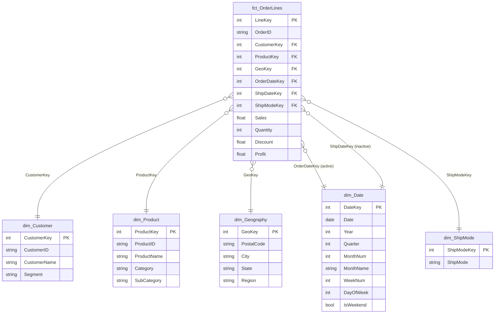

# CONTEXT — retail-profitability

## Business question and KPIs

**Business question:** What drives profitability? Which customer segments, regions, and
product categories generate the most/least profit — and what levers (discount rate, ship
mode, order size) affect it?

**Primary KPI:** Profit Margin % = SUM(Profit) / SUM(Sales)

| KPI | Measure | Notes |
|---|---|---|
| Profit Margin % | `[Profit Margin %]` | Primary. Rates, not totals. |
| Profit by Segment / Region / Category / Sub-Category | `[Total Profit]` sliced by dims | Use with `[Profit Margin %]` to avoid size bias |
| Discount Impact on Profit | `[Avg Discount]`, `[Profit Margin %]` | Correlational only — see analytical limits |
| Sales and Profit YoY trend | `[Sales YoY %]`, `[Profit YoY %]` | Requires Year or Date on visual axis |
| Top/bottom 10 products by profit margin | `[Profit Margin %]` on dim_Product[ProductName] | Use TopN filter |

**Analytical limit:** Profit is a pre-computed field in the source data. Discount impact
analysis is **correlational only** — we can observe that higher discounts correlate with
lower margins, but we cannot decompose into margin erosion vs. volume lift because no
cost breakdown is available.

---

## Star schema

**Relationships:** All Many-to-One, single direction, fact to dim.
`fct_OrderLines[OrderDateKey] -> dim_Date[DateKey]` is the **active** relationship.
`fct_OrderLines[ShipDateKey] -> dim_Date[DateKey]` is **inactive** — use
`USERELATIONSHIP` in a measure to analyse by ship date.

**Grain note:** One row = one product line on one order. `[Order Count]` requires
`DISTINCTCOUNT(fct_OrderLines[OrderID])` — not `COUNTROWS` — because a multi-product
order spans several rows.

---

## Data source

**Dataset:** Pavan Lalwani — US Superstore retail dataset, 2020-2021.
**Format:** 49 CSV files, one per US state, cp1252 encoding.
**Source path:** `projects/retail-profitability/_data/` (gitignored).
**Processed output:** `projects/retail-profitability/_output/` (gitignored).
**Ingestion script:** `projects/retail-profitability/scripts/01_union_and_clean.py`

---

## Data quality issues resolved

| Issue | Resolution |
|---|---|
| `Delaware.csv` — empty file | Skipped at load; logged in script output |
| `New Jersey - Copy.csv` — exact duplicate of `New Jersey.csv` | Skipped at load |
| `US-2018-150119 / FUR-CH-10002965` (Ohio) — exact duplicate row | Dropped via `drop_duplicates(keep="first")` on all columns; reproducible |
| 7 split-shipment pairs (14 rows) — same (Order ID, Product ID), different quantities | Retained as distinct line items; `LineKey` is the grain key, not `(Order ID, Product ID)` |
| Postal Code — nulls and float coercion (e.g. `"10001.0"`) | Null -> `"00000"` sentinel; strip `.0`; zero-pad to 5 digits |
| Row ID — not globally unique across files | Dropped; replaced by `LineKey` (1-based integer row index) |
| Encoding — not UTF-8 | Read with `encoding="cp1252"`; output written as UTF-8 |

---

## Row counts (after cleaning)

| Table | Rows |
|---|---|
| fct_OrderLines | 9,887 |
| dim_Customer | 793 |
| dim_Product | 1,861 |
| dim_Geography | 627 |
| dim_Date | 1,464 (2018-01-03 to 2021-12-30) |
| dim_ShipMode | 4 |

**dim_Date span note:** The date spine covers 2018–2021 (4 years) because the source
contains orders from 2018 (`US-2018-*` order IDs), not just 2020-2021 as the brief
estimated. This is correct.

---

## AI-readiness gates applied

| Phase | Gate | Status |
|---|---|---|
| 2a | Surrogate keys on all dimensions | Done |
| 2b | Descriptions on all tables | Done |
| 2c | Key columns hidden from report view | Done |
| 3a | dataCategory: "Date" on dim_Date[Date] | Done |

**Not yet applied:** synonyms (Phase 3b), measure descriptions surfaced as Q&A
phrasings, report page titles.

---

## Measure library

All measures live in the hidden `_Measures` calculated table.

| Folder | Measure | Format |
|---|---|---|
| Sales | `[Total Sales]` | #,0.00 |
| Sales | `[Avg Order Value]` | #,0.00 |
| Sales | `[Sales YoY %]` | 0.0% |
| Profit | `[Total Profit]` | #,0.00 |
| Profit | `[Profit Margin %]` | 0.0% |
| Profit | `[Profit YoY %]` | 0.0% |
| Profit | `[% Lines Profitable]` | 0.0% |
| Volume | `[Total Quantity]` | #,0 |
| Volume | `[Order Count]` | #,0 |
| Volume | `[Customer Count]` | #,0 |
| Volume | `[Avg Discount]` | 0.0% |
| Volume | `[Avg Discount (Discounted Only)]` | 0.0% |

---

## Open items

- Report pages not yet built
- Synonyms not yet configured (Q&A / Copilot phrasing)
- No RLS required for this portfolio project
