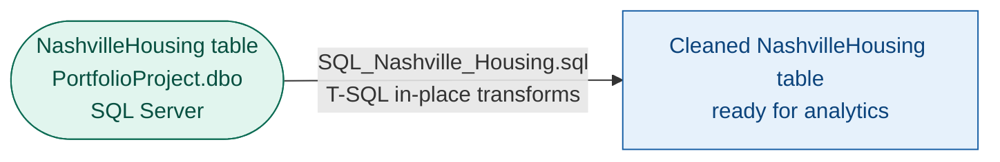

# Nashville Housing Data Cleaning — Full SQL transformation pipeline for downstream analytics

A complete data cleaning and transformation workflow in T-SQL (SQL Server / SSMS 21)
preparing raw Nashville housing transaction data for downstream analytics. Demonstrates
real-world data engineering techniques: address enrichment via self-join, deduplication
with window functions, schema evolution, and string parsing — applied to a public
Nashville property sales dataset.

---

## The Problem

Raw Nashville housing transaction data is analytically unusable in its original state:
addresses are incomplete, dates are inconsistently formatted, a boolean field uses
non-standard values, duplicate rows exist, and unused columns inflate the schema.

**NULL `PropertyAddress` values.** Some rows are missing the property address but
share a `ParcelID` with other rows that have it — a self-join can populate the gap
using existing data rather than dropping rows.

**Non-standard field values.** `SoldAsVacant` stores `Y` / `N` rather than
`Yes` / `No` — inconsistent with the other values in the same column, breaking
downstream GROUP BY and filter logic.

**Duplicate rows.** The source contains exact duplicates partitioned by key
business columns. A naive deduplication by all columns would retain too many rows;
`ROW_NUMBER()` partitioned by the meaningful key columns identifies true duplicates.

---

## Architecture

---

## Key Technical Decisions

- **All transformations are in-place (schema modification via `ALTER TABLE`)** — no
  staging table is created. This is a data engineering demonstration script, not a
  production ETL pipeline; in production, transformations would write to a separate
  cleaned table to preserve the raw layer.

- **Self-join for NULL address enrichment** — `PropertyAddress` is populated by
  joining the table to itself on `ParcelID` where the target row has a NULL address
  and the source row does not. This recovers address data without dropping rows or
  requiring an external lookup.

- **`ROW_NUMBER()` for deduplication, not `DISTINCT`** — `DISTINCT` would require
  all columns to match. `ROW_NUMBER()` partitioned by the business key columns
  (`ParcelID`, `PropertyAddress`, `SaleDate`, `SalePrice`, `LegalReference`) targets
  true transactional duplicates while preserving legitimately different rows that share
  some column values.

- **`PARSENAME()` for address splitting** — `PARSENAME` treats the address string as
  a dot-delimited object name; replacing the delimiter character (comma) with a dot
  enables extracting address components without a custom string parsing function.

---

## What Was Built

| Artifact | Type | Description |
|---|---|---|
| `SQL_Nashville_Housing.sql` | T-SQL script | Full cleaning pipeline — 7 transformation steps, executable sequentially in SSMS |

---

## Transformations Performed

| Step | Transformation |
|---|---|
| 1 | Date format standardisation — `SaleDate` column |
| 2 | NULL `PropertyAddress` population via self-join on `ParcelID` |
| 3 | Address splitting — `PropertyAddress` and `OwnerAddress` parsed into separate street/city/state columns |
| 4 | `SoldAsVacant` normalisation — `Y` → `Yes`, `N` → `No` |
| 5 | Deduplication — `ROW_NUMBER()` partitioned by 5-column business key; duplicates deleted |
| 6 | Unused column removal — `ALTER TABLE ... DROP COLUMN` |

---

## Key Skills Demonstrated

- Self-joins for data enrichment from within the same table
- `ROW_NUMBER()` window functions for deduplication
- Schema evolution with `ALTER TABLE ADD COLUMN` and `DROP COLUMN`
- String parsing with `SUBSTRING`, `CHARINDEX`, and `PARSENAME`
- Date conversion with `CONVERT`
- Modular, readable SQL structure with inline comments per step

---

## How to Use This Project

1. Import the Nashville Housing dataset into SQL Server as `PortfolioProject.dbo.NashvilleHousing`
2. Open `SQL_Nashville_Housing.sql` in SSMS 21
3. Execute sequentially — each step is separated by a comment header and can be run independently
4. Verify the final cleaned table with the SELECT statements at the end of each section

- **`CLAUDE.md`** — project goal, grain, data sources, constraints, SQL dialect notes
- **`state.md`** — current status and next actions

---

## Data

| Field | Detail |
|---|---|
| Source | Nashville Housing public dataset (SQL Server import) |
| Grain | One row per property sale transaction |
| Table | `PortfolioProject.dbo.NashvilleHousing` |
| Dialect | T-SQL / SQL Server (SSMS 21) — not portable to other dialects without modification |
| Known gaps | No raw data file in repo — dataset must be imported into SQL Server before running |

---

*Built by [Ali Saghi](https://www.linkedin.com/in/ali-saghi-fabric/) · [Lotusoftware](https://lotusoftware.hashnode.dev) · October 2026*
