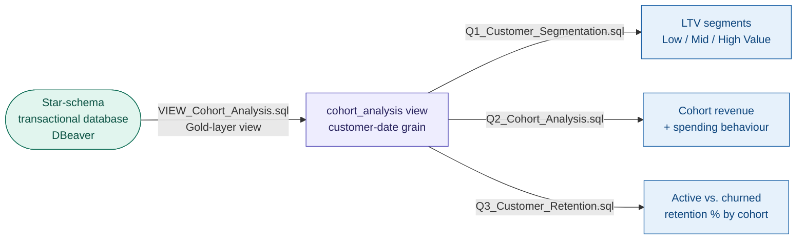

# Customer Segmentation, Cohorts & Retention — LTV segmentation, cohort revenue, and retention analytics in SQL

An end-to-end SQL analytics project answering three questions about customer value over
time: how customers segment by lifetime value, how cohorts perform in revenue at
acquisition time, and how many customers remain active versus churned across cohort
years — built on a star-schema transactional database using DBeaver.

---

## The Problem

The business has customer transaction data but no structured view of customer value,
cohort behaviour, or retention over time. Aggregate revenue metrics mask the fact that
a small high-value segment drives most revenue, and that most customers churn within
six months of acquisition.

**LTV is invisible at the aggregate level.** Revenue totals do not reveal whether the
business is driven by many average customers or a few high-value ones. Percentile-based
LTV segmentation makes this structure visible and actionable.

**Cohort revenue hides an inactive customer population.** Average revenue per customer
includes zero-spend customers in the denominator — dramatically understating the revenue
productivity of spending customers and obscuring the size of the inactive base.

**Retention looks better than it is.** Without a consistent churn definition (no
purchase in last 6 months) applied uniformly across cohort years, retention reporting
produces incomparable numbers across time.

---

## Architecture

---

## Key Technical Decisions

- **Gold-layer view pattern (`cohort_analysis`)** — aggregates transactions to
  customer–date grain, derives first purchase date, assigns cohort year, and cleans
  customer names once in the view rather than in every query. Mimics modern data
  platform architecture; avoids duplicating business logic across Q1–Q3.

- **Percentile-based LTV segmentation (25th/75th)** — industry-standard approach;
  avoids arbitrary hard-coded thresholds. The 25th percentile separates Low Value,
  the 75th separates High Value, with Mid Value in between.

- **LEFT JOIN in Q2 Part B** — deliberately includes zero-spend customers in the
  denominator to surface the inactive customer population. Average revenue per
  *spending* customer is more than double the all-customer average — the gap is the
  primary business insight on this page.

- **Window functions (`ROW_NUMBER`, `MAX`) for retention logic** — identifies each
  customer's most recent purchase date without subquery nesting, then classifies
  active vs. churned against the 6-month threshold. Keeps the retention query
  readable and performant.

---

## What Was Built

| Artifact | Type | Description |
|---|---|---|
| `VIEW_Cohort_Analysis.sql` | SQL view | Gold-layer analytical view — customer–date grain, first purchase date, cohort year, cleaned names |
| `Q1_Customer_Segmentation.sql` | SQL query | LTV segmentation using 25th/75th percentile breakpoints |
| `Q2_Cohort_Analysis.sql` | SQL query | Part A: cohort revenue by year; Part B: spending behaviour (active customers vs. all) |
| `Q3_Customer_Retention.sql` | SQL query | Active vs. churned classification; retention % by cohort year |
| `Optimized_Queries.sql` | SQL script | Consolidated optimised versions of Q1–Q3 for production use |

---

## Key Findings

- **High-value customers represent a smaller segment but contribute the majority of
  lifetime revenue** — the standard power-law concentration in B2C transactional data.
- **Average revenue per spending customer is more than double the overall average** —
  the inactive customer base is large and suppresses aggregate metrics significantly.
- **Customer churn remains consistently high across cohorts** — only ~9–10% of customers
  remain active after 6 months. Acquisition-period retention is the primary lever.

**Analyst blind spots acknowledged:** Churn is defined as no purchase in 6 months —
a behavioural proxy, not a confirmed opt-out. Cohort grain is annual; finer grain would
reveal within-year retention drop-off patterns. Analysis assumes a stable upstream schema;
the `cohort_analysis` view does not validate source data quality.

---

## How to Use This Project

1. Connect DBeaver to the star-schema transactional database
2. Run `VIEW_Cohort_Analysis.sql` first to create the Gold-layer analytical view
3. Run Q1 → Q2 → Q3 in sequence, or use `Optimized_Queries.sql` for the consolidated version
4. Each script is self-contained; re-run any query independently after view creation

- **`CLAUDE.md`** — project goal, KPIs, grain, data sources, constraints, churn definition
- **`state.md`** — current status and next actions

---

## Data

| Field | Detail |
|---|---|
| Source | Star-schema transactional database (accessed via DBeaver) |
| Grain | Customer–order date (via `cohort_analysis` view) |
| Churn definition | No purchase in last 6 months |
| Cohort grain | Annual (first purchase year) |
| Known gaps | Upstream schema assumed stable; no source data quality validation in scripts |

---

*Built by [Ali Saghi](https://www.linkedin.com/in/ali-saghi-fabric/) · [Lotusoftware](https://lotusoftware.hashnode.dev) · October 2026*
