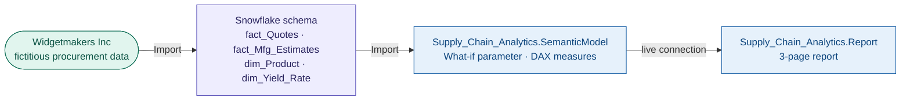

# Make-or-Buy Decision Support — Volume break-even analysis for Widgetmakers Inc procurement

A Power BI decision-support report answering, for each part number and production
volume, whether Widgetmakers Inc should manufacture internally or buy from one of
four external suppliers — and identifying the exact volume threshold where the
recommendation switches, so procurement has a data-backed position before committing
to capital investment or a supply contract.

---

## The Problem

Widgetmakers' procurement team needs to decide, for each part number and production
volume, whether to manufacture internally or buy from one of four external suppliers.
The wrong decision at any volume point means unnecessary capital investment or an
avoidable unit cost premium.

**The recommendation changes with volume.** Make is cheaper above a break-even
threshold that is different for every part number. A static comparison table answers
the question at one volume only — missing the full decision space.

**Extended cost is a misleading metric.** Non-recurring expenses (tooling, setup) vary
significantly between suppliers. The lowest unit cost supplier is not always the lowest
full cost supplier at low volumes. A procurement team comparing unit prices alone will
overpay on low-volume parts.

**Capital investment is invisible in cost comparisons.** A "Make is cheaper" conclusion
that hides machine investment payback period is not actionable. The capital requirement
must be surfaced alongside the cost comparison.

---

## Architecture

---

## Key Technical Decisions

- **What-if parameter (Scenario Volume)** — all cost measures recalculate dynamically
  as volume changes; cost curves plotted across the full range make break-even points
  visible without manual recalculation.

- **Three-page decision progression** — Supplier Selection (cheapest supplier at a
  fixed volume) → Scenario Analysis (volume-varying cost curves) → Make vs. Buy (full
  cost comparison with capital investment visibility). Mirrors the actual procurement
  analyst workflow: select, stress-test, then decide.

- **`Buy Scenario Full Cost` uses `MINX + FILTER` on Quotes** — selects minimum full
  cost supplier at scenario volume, not just lowest unit cost; exposes whether the
  advantage is from unit price or setup cost, which are different negotiation levers.

- **Capital Investment Required (Make) on the Make vs. Buy page** — prevents the
  "Make looks cheaper" conclusion from hiding machine investment. Payback period
  requires a demand forecast not present in this dataset — documented gap.

- **Yield rate applied to Buy scenario only** — quality-adjusted cost = unit cost /
  yield rate. Make scenario does not yet adjust for internal scrap rates — documented
  asymmetry that slightly overstates the Make cost advantage in scrap-intensive parts.

---

## What Was Built

| Artifact | Type | Description |
|---|---|---|
| `Supply_Chain_Analytics.Report` | Report | 3-page Power BI report — Supplier Selection, Scenario Analysis, Make vs. Buy |
| `Supply_Chain_Analytics.SemanticModel` | Semantic model | Import · snowflake schema · What-if Scenario Volume parameter · DAX measures |

---

## Semantic Model — DAX Measure Library

| Display folder | What it answers |
|---|---|
| Buy | Full Cost (Buy), Buy Scenario Full Cost (minimum full cost across suppliers at scenario volume) |
| Make | Make Scenario Full Cost (internal cost at scenario volume), Capital Investment Required |
| Decision | Make vs. Buy decision flag, Cost Avoidance (`ABS([Make] - [Buy]`) |

---

## Report Pages

**Page 1 — Supplier Selection**
Supplier cost comparison at a fixed volume, ranked by full cost (unit + non-recurring).
Identifies cheapest supplier per part at current production volume. Slicers: part number.

**Page 2 — Scenario Analysis**
What-if Scenario Volume slider, cost curves for all four suppliers across the volume
range, break-even markers. Answers "at what volume does the recommendation change?"

**Page 3 — Make vs. Buy**
Full cost comparison (Make vs. cheapest Buy), Cost Avoidance measure, Capital
Investment Required (Make). Decision flag per part number at scenario volume.

---

## Key Findings

- **Widgetmakers Inc is the lowest-cost Buy option** across most part numbers and
  volumes — unit cost advantage compounds at higher volumes.
- **Make becomes preferable above a volume threshold specific to each part** — break-even
  is not uniform; high-machine-capacity parts reach Make viability at lower volumes.
- **Non-recurring expenses vary significantly between suppliers** — extended cost alone
  is a misleading comparison metric at low volumes.
- **Capital investment requirements are material** — payback period calculation requires
  a demand forecast not present in this dataset.

**Analyst blind spots acknowledged:** Fictitious Widgetmakers Inc dataset — decision
logic transfers but specific numbers do not. Non-recurring expenses are treated as
fully upfront (not amortised) — this overstates the cost disadvantage of high-setup
Buy options at low volumes. No temporal dimension in this model — time intelligence
measures are not applicable.

---

## How to Explore This Project

- **Report:** `Supply_Chain_Analytics.Report/definition/pages/` — PBIR visual JSON per page
- **Semantic model:** `Supply_Chain_Analytics.SemanticModel/definition/tables/_Measures.tmdl` — all DAX measures and the Scenario Volume What-if parameter
- **`CLAUDE.md`** — project goal, KPIs, grain, data sources, constraints, yield rate asymmetry note
- **`decisions.md`** — dated log of design decisions with rationale
- **`state.md`** — current status, blockers, and next actions

---

## Data

| Field | Detail |
|---|---|
| Source | Widgetmakers Inc fictitious procurement dataset |
| Grain | One row per supplier quote (Part Number × Supplier × Volume tier) |
| Tables | `fact_Quotes`, `fact_Mfg_Estimates`, `dim_Product`, `dim_Yield_Rate` |
| Known gaps | No temporal dimension; yield rate asymmetry (Buy adjusted, Make not); NRE treated as upfront |

---

*Built by [Ali Saghi](https://www.linkedin.com/in/ali-saghi-fabric/) · [Lotusoftware](https://lotusoftware.hashnode.dev) · October 2026*
